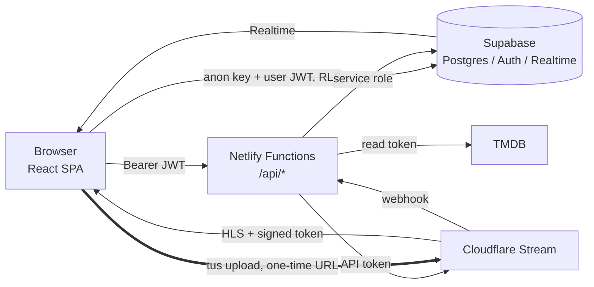

# CineVault

A real-time movie database and streaming website.

| Concern | Technology |
| --- | --- |
| Frontend | React 19, Vite, TypeScript, Tailwind CSS 4, Lucide icons |
| Database / Auth / Realtime / image storage | Supabase (PostgreSQL, Auth, Realtime, Storage) |
| Video upload and streaming | Cloudflare Stream (resumable direct uploads, signed HLS playback) |
| Metadata | TMDB API (manual entry always works as a fallback) |
| Hosting and backend functions | Netlify + Netlify Functions |

All catalogue data comes from the database. Sample movies appear **only** when you explicitly set `VITE_DEMO_MODE=true`, and the UI then shows a "DEMO MODE" banner.

## Architecture



Upload flow:

1. The admin fills the Add Movie form and picks a video file.
2. `POST /api/create-upload` verifies the caller's JWT, then **loads their role from the database** (never from the client). It validates the file type and size, rate-limits, and asks Cloudflare for a one-time tus upload URL. It then creates the movie row (`draft`, `uploading`) and an `uploads` record.
3. The browser uploads **directly to Cloudflare** with `tus-js-client` (chunked, automatic retry, "Retry upload" resumes after interruptions). The video never touches Netlify.
4. Cloudflare processes the video and calls `/api/cloudflare-webhook` (HMAC-verified). The dashboard also polls `/api/video-status`. Both sync `upload_status` into Supabase.
5. A database constraint (`movies_published_requires_ready`) makes it impossible to publish a movie until `upload_status = 'ready'`. The admin then clicks Publish.
6. Supabase Realtime pushes the change to connected users, and rows, rails and the Recently Added section update without a refresh.

Playback: the Watch page calls `/api/playback-token`. The function checks that the movie is published and ready (admins may preview drafts), then signs a short-lived RS256 token locally. Videos are created with `requiresignedurls`, so the raw video ID cannot be played without a token.

## Prerequisites

* Node.js 20.19+ (22 LTS recommended) and npm
* Git and a GitHub account
* Accounts: [Supabase](https://supabase.com), [Cloudflare](https://dash.cloudflare.com) (with Stream enabled), [Netlify](https://netlify.com), and optionally [TMDB](https://www.themoviedb.org/settings/api)
* [Netlify CLI](https://docs.netlify.com/cli/get-started/) for local function testing: `npm i -g netlify-cli`

## 1. Quick preview (no accounts needed)

```bash
npm install
echo VITE_DEMO_MODE=true > .env
npm run dev          # http://127.0.0.1:5173
```

Demo mode shows 10 fictional sample movies. Accounts, uploads and playback are disabled.

## 2. Supabase setup

1. Create a project. Copy the **Project URL**, the **anon/publishable key** and the **service-role/secret key** (Project Settings → API).
2. In the **SQL Editor**, run the three files in `supabase/migrations/` **in order**:
   1. `20250101000000_schema.sql`: tables, constraints, indexes, triggers, RPCs
   2. `20250101000100_rls_policies.sql`: Row Level Security and column-level grants
   3. `20250101000200_realtime_storage_seed.sql`: Realtime publication, the `posters` bucket and its policies, and genre reference data

   (With the Supabase CLI: `supabase link --project-ref <ref> && supabase db push`.)
3. **Authentication → URL Configuration**: set *Site URL* to your Netlify URL and add `http://127.0.0.1:5173/**` and `https://YOUR-SITE.netlify.app/reset-password` to *Redirect URLs*.
4. **Authentication → Providers → Email**: keep "Confirm email" enabled for production, and set a minimum password length of 8 or more.
5. **Create the first administrator.** Sign up through the site, then in the SQL Editor run:

   ```sql
   update public.profiles set role = 'admin'
   where id = (select id from auth.users where email = 'you@example.com');
   ```

   Admin status can only be granted this way (SQL editor or service role). A trigger rejects role changes from any signed-in user, and `role` is not in the client-writable column grants.

### Security model (summary)

| Table | anon | authenticated user | admin |
| --- | --- | --- | --- |
| `movies` | SELECT published and ready only | same | SELECT all; INSERT/UPDATE editorial columns only |
| `profiles` | none | SELECT/UPDATE own `display_name`/`avatar_url` | SELECT all |
| `watchlist`, `viewing_history`, `reviews` | none | own rows only | no extra access |
| `uploads` | none | none | SELECT |
| `rate_limits` | none | none | none (service role only) |

* Video columns (`video_asset_id`, `upload_status`) are not client-writable. Only the Netlify Functions (service role) and the webhook can set them.
* Movies are deleted through `/api/delete-movie` so the Cloudflare asset is removed too. There is no client `DELETE` grant.
* Realtime `postgres_changes` is evaluated against RLS per subscriber. Because a subscriber can't receive an event for a row it can no longer see (unpublish) or for a `DELETE`, a trigger broadcasts an **id-only** `movie_removed` message so open pages drop the movie immediately.

## 3. Cloudflare Stream setup

1. **Account ID**: dashboard sidebar → Stream (or Workers & Pages overview).
2. **API token**: My Profile → API Tokens → Create Token → permissions *Account → Stream → Edit* → `CLOUDFLARE_STREAM_API_TOKEN`.
3. **Customer code**: Stream dashboard → any video's embed/HLS URL looks like `customer-<CODE>.cloudflarestream.com` → `CLOUDFLARE_STREAM_CUSTOMER_CODE=<CODE>`.
4. **Signing key** (for signed playback). Run once:

   ```bash
   curl -X POST "https://api.cloudflare.com/client/v4/accounts/$CLOUDFLARE_ACCOUNT_ID/stream/keys" \
     -H "Authorization: Bearer $CLOUDFLARE_STREAM_API_TOKEN"
   ```

   Save `result.id` → `CLOUDFLARE_STREAM_SIGNING_KEY_ID` and `result.pem` (base64, use as-is) → `CLOUDFLARE_STREAM_SIGNING_KEY_PEM`. The PEM is shown once, so store it in Netlify immediately.
5. **Webhook** (after the first deploy):

   ```bash
   curl -X PUT "https://api.cloudflare.com/client/v4/accounts/$CLOUDFLARE_ACCOUNT_ID/stream/webhook" \
     -H "Authorization: Bearer $CLOUDFLARE_STREAM_API_TOKEN" -H "Content-Type: application/json" \
     --data '{"notificationUrl":"https://YOUR-SITE.netlify.app/api/cloudflare-webhook"}'
   ```

   Save the returned `secret` → `CLOUDFLARE_STREAM_WEBHOOK_SECRET`. The webhook is optional: the admin dashboard also polls video status, but the webhook keeps statuses correct when no admin has the page open.
6. Optionally add **Allowed origins** to your Stream settings to restrict playback to your domain.

## 4. TMDB (optional)

Create a free account → Settings → API → copy the **API Read Access Token** → `TMDB_API_READ_TOKEN`. It is only used inside `/api/tmdb` (admin-only). Without it, the lookup shows an error and you enter metadata manually.

## 5. Environment variables

See [`.env.example`](.env.example) for the full list.

| Variable | Scope | Purpose |
| --- | --- | --- |
| `VITE_SUPABASE_URL` | Public | Supabase project URL |
| `VITE_SUPABASE_ANON_KEY` | Public | Anon/publishable key (safe in browser; RLS protects data) |
| `VITE_DEMO_MODE` | Public | `true` enables labelled sample data |
| `VITE_MAX_UPLOAD_MB` | Public | Client-side upload size hint |
| `SUPABASE_URL` | Server | Optional; falls back to `VITE_SUPABASE_URL` |
| `SUPABASE_SERVICE_ROLE_KEY` | **Secret** | Bypasses RLS; Functions only |
| `CLOUDFLARE_ACCOUNT_ID` | Server | |
| `CLOUDFLARE_STREAM_API_TOKEN` | **Secret** | Create uploads, read status, delete videos |
| `CLOUDFLARE_STREAM_CUSTOMER_CODE` | Server | HLS host |
| `CLOUDFLARE_STREAM_SIGNING_KEY_ID` / `_PEM` | **Secret** | Signs playback tokens |
| `CLOUDFLARE_STREAM_WEBHOOK_SECRET` | **Secret** | Verifies webhooks |
| `TMDB_API_READ_TOKEN` | **Secret** | TMDB lookups |
| `MAX_UPLOAD_BYTES` | Server | Server-enforced upload limit (default 10 GiB) |
| `MAX_VIDEO_DURATION_SECONDS` | Server | Cloudflare maximum duration (default 6 h) |
| `PLAYBACK_TOKEN_TTL_SECONDS` | Server | Token lifetime (default 4 h) |

Only `VITE_*` variables are bundled into the browser. Never add `VITE_` to a secret. In Netlify, mark secrets with **Contains secret values**.

## 6. Run locally with functions

```bash
cp .env.example .env     # fill in values; .env is git-ignored
netlify dev              # serves Vite and /api/* functions together
```

Use `netlify dev` (not plain `npm run dev`) for upload, playback and TMDB features, because they depend on the functions.

## 7. Deploy to Netlify via GitHub

```bash
git init -b main
git add .
git commit -m "Initial commit: CineVault"
git remote add origin https://github.com/<you>/cinevault.git
git push -u origin main
```

1. Netlify → **Add new site → Import an existing project** → pick the GitHub repo.
2. Build settings are read from [`netlify.toml`](netlify.toml) (`npm run build`, publish `dist`, functions in `netlify/functions`).
3. Add every variable from section 5 under **Site configuration → Environment variables**.
4. Deploy, then complete the Cloudflare webhook step (section 3.5) and the Supabase redirect URLs (section 2.3) with the final URL.

`netlify.toml` includes the SPA fallback (`/* → /index.html`, status 200), so deep links such as `/movie/<id>` work. It also sets security headers (HSTS, CSP, `X-Frame-Options`, and others).

**Note:** Netlify Functions are only used for small JSON requests (create upload URL, status, token, TMDB, delete). Video bytes go browser → Cloudflare directly.

## 8. Production build verification

```bash
npm ci
npm run typecheck     # TypeScript, strict mode
npm test              # security-critical unit tests (webhook HMAC, JWT signing, validation)
npm run build         # type-check + production bundle in dist/
npm run preview       # serve dist/ locally
```

Post-deploy checklist:

- [ ] Opening `/movie/<id>` directly (hard refresh) loads the page.
- [ ] A normal user visiting `/admin` is redirected, and calling `/api/create-upload` with their token returns `403`.
- [ ] In the browser DevTools, no network response or JS bundle contains a service-role key, a Cloudflare token or a TMDB token.
- [ ] Upload a small MP4 → status goes `uploading → processing → ready` → publish → it appears for a second open browser tab without a refresh → unpublish → it disappears.
- [ ] Unauthenticated requests to `viewing_history` or `watchlist` via the REST API return no rows.
- [ ] Run Supabase **Advisors → Security** and fix any warnings.

## 9. Project layout

```
netlify/
  functions/        create-upload, video-status, playback-token, delete-movie, tmdb, cloudflare-webhook
  lib/              auth + rate limit (server.ts), Cloudflare client + token signing, HTTP helpers
src/
  components/       Layout, SearchBar, MovieCard/Row, Hero, VideoPlayer, ui
  context/          Auth, Catalog (Realtime), Watchlist
  lib/              Supabase client, queries, api client, tus upload, zod schemas, demo data
  pages/            Home, Browse, Genres, MovieDetail, Watch, Login, Profile, Watchlist, admin/*
supabase/migrations/  3 ordered SQL files
tests/                Vitest unit tests
```

## Known limitations and notes

* **Legal pages** (Privacy, Terms, Contact) are templates. Have them reviewed and add your own contact address before launch.
* **Rate limiting** is a per-user fixed window stored in Postgres, applied to all functions. Add Netlify/Cloudflare edge rate limiting for per-IP protection on the public webhook and login endpoints. Supabase Auth has its own built-in limits for sign-in and reset e-mails.
* **Signed-token refresh:** tokens last 4 h by default (`PLAYBACK_TOKEN_TTL_SECONDS`). If a token expires mid-session the player requests a fresh one automatically. Raise the TTL for very long films.
* **Subtitles** appear in the player when the HLS manifest has subtitle tracks. Add captions to a video in Cloudflare Stream (dashboard or the captions API) and they show up automatically.
* **Delete protection:** only a role change in SQL can create admins. Review who has dashboard access to Supabase, Cloudflare and Netlify, because they bypass application-level controls.
* Only upload content you own or are licensed to distribute.

## License

Choose a license for your project (MIT or Apache-2.0 recommended).
